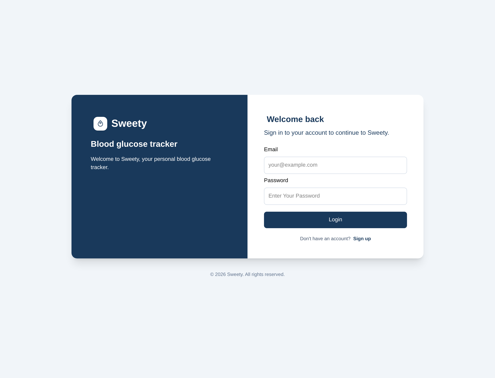
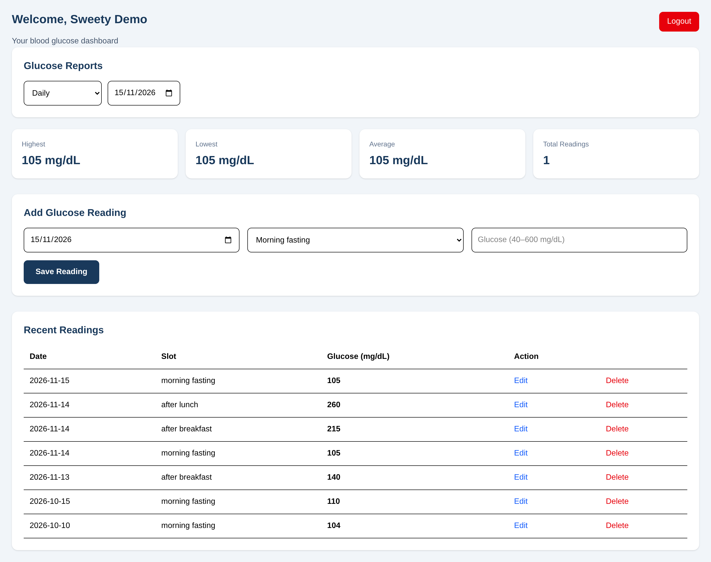
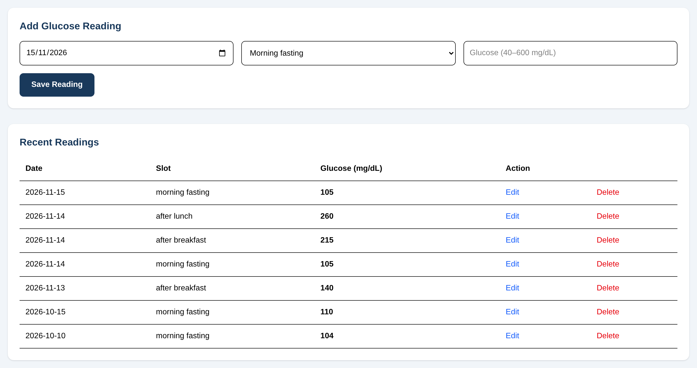
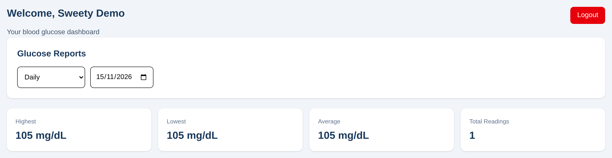
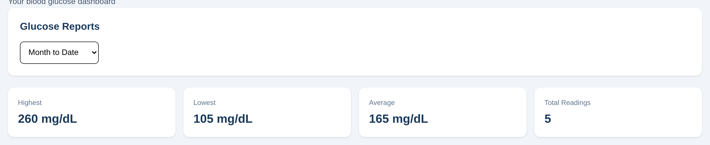

# Sweety – Blood Glucose Tracker

A full-stack blood glucose tracking application built with React, Node.js, Express, and PostgreSQL. Users can securely record their daily glucose readings and view reports with statistical summaries.

## Features

### Authentication
- User registration and login
- Password hashing using bcrypt
- JWT-based authentication
- Protected API routes
- User-specific reading access

### Glucose Reading Management
- Create, view, update, and delete glucose readings
- Four daily reading slots:
  - Morning fasting
  - After breakfast
  - After lunch
  - After dinner
- Glucose values restricted to 40–600 mg/dL
- Prevents future-dated readings
- Prevents duplicate slots for the same user and date

### Reports
- Daily report
- Month-to-date report
- Previous full-month report
- Highest, lowest, average, and total reading count
- Empty-state handling when no readings exist

## Screenshots

### Login


### Dashboard


### Reading Management


### Reports


### Month-to-Date Report


## Technology Stack

| Layer | Technology |
|---|---|
| Frontend | React, Vite |
| Styling | Tailwind CSS |
| Backend | Node.js, Express.js |
| Database | PostgreSQL |
| ORM | Sequelize |
| Authentication | JWT, bcrypt |
| API Testing | Postman |

## Project Structure

```text
sweety/
├── client/
│   ├── src/
│   ├── package.json
│   └── ...
├── server/
│   ├── src/
│   │   ├── config/
│   │   ├── controllers/
│   │   ├── middleware/
│   │   ├── migrations/
│   │   ├── models/
│   │   ├── routes/
│   │   └── seeders/
│   ├── .env.example
│   └── package.json
└── README.md
```

## Prerequisites

- Node.js and npm
- PostgreSQL
- Git

## Installation and Setup

### 1. Clone the repository

```bash
git clone https://github.com/KelvinChovatiya/sweety.git
cd sweety
```

### 2. Set up the database

Create a PostgreSQL database and user, then execute the SQL schema in:

`server/src/config/schema.sql`

The database schema defines the users and glucose readings tables, including the required constraints.

### 3. Configure the backend

```bash
cd server
npm install
```

Copy `.env.example` to `.env` and configure your database credentials and JWT secret.

Required environment variables:

```env
PORT=5000
DB_HOST=localhost
DB_PORT=5432
DB_NAME=sweety
DB_USER=your_database_user
DB_PASSWORD=your_database_password
JWT_SECRET=your_jwt_secret
```

### 4. Seed demo data

```bash
npm run seed:demo
```

### 5. Start the backend

```bash
npm run dev
```

The API will run at:

`http://localhost:5000`

### 6. Set up the frontend

Open another terminal:

```bash
cd client
npm install
npm run dev
```

Open the Vite development URL shown in your terminal.

## Demo Credentials

| Field | Value |
|---|---|
| Email | demo@sweety.com |
| Password | SweetyDemo123! |

These credentials are for demonstration purposes only.

## API Endpoints

All protected endpoints require:

`Authorization: Bearer <JWT_TOKEN>`

### Authentication

| Method | Endpoint | Description |
|---|---|---|
| POST | `/api/auth/signup` | Register a user |
| POST | `/api/auth/login` | Log in |

### Glucose Readings

| Method | Endpoint | Description |
|---|---|---|
| POST | `/api/readings` | Create a reading |
| GET | `/api/readings` | Get logged-in user's readings |
| PUT | `/api/readings/:id` | Update a reading |
| DELETE | `/api/readings/:id` | Delete a reading |

### Reports

| Method | Endpoint | Description |
|---|---|---|
| GET | `/api/reports/daily?date=YYYY-MM-DD` | Daily report |
| GET | `/api/reports/month-to-date` | Current month report |
| GET | `/api/reports/previous-month` | Previous full-month report |

## Validation Rules

- Reading date must use `YYYY-MM-DD` format.
- Future dates are not allowed.
- Glucose values must be integers between 40 and 600 mg/dL.
- Only the four predefined reading slots are accepted.
- Each user can have only one reading per slot per day.
- Users can only access their own readings.

## Assumptions and Notes

- The application uses one reading per user, date, and slot.
- The four allowed slots and unique database constraint enforce a maximum of four readings per day.
- Report statistics are calculated from the logged-in user's readings.
- Empty reports return `null` for highest, lowest, and average, with a count of zero.
- The database schema is provided as SQL rather than being recreated with Sequelize synchronization.


## Testing

The application was manually tested using the frontend and Postman.

Verified scenarios:

- User signup and login
- Protected routes and JWT authentication
- Creating, viewing, updating, and deleting readings
- Glucose validation (40–600 mg/dL)
- Duplicate reading prevention
- Future-date rejection
- User-specific reading access
- Daily, month-to-date, and previous-month reports
- Empty report handling

Automated tests are not currently included.

## Future Improvements

- Interactive glucose charts
- Pagination and date filtering
- Automated backend tests
- Docker-based setup
- Improved reporting and export options
